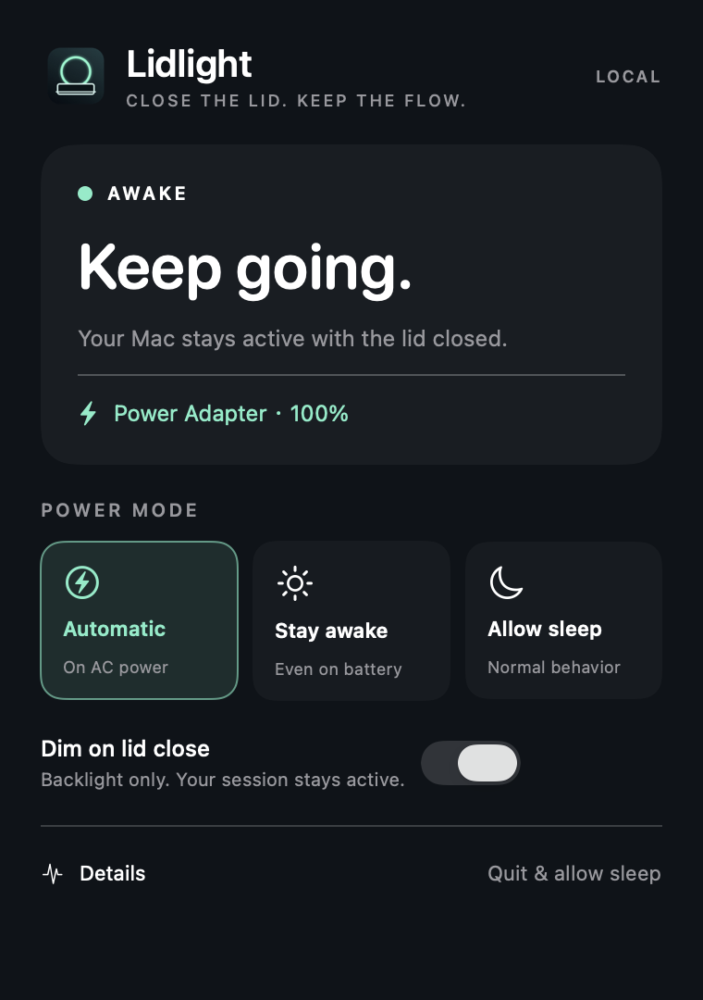
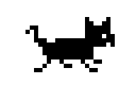

# Lidlight

A focused macOS menu bar app that keeps your MacBook awake with the lid closed.



Layout preview with solid accessibility surfaces and sample quota data. macOS 26 uses clear native Liquid Glass for controls and navigation, with clear glass content surfaces and a subtle iris/mist/peach gradient. Lavender accents adapt to light and dark appearances. Appearance follows the system; Reduce Transparency uses solid surfaces. macOS 12–15 use standard materials.

## Features

- Automatic, Stay awake and Allow sleep, with confirmation of actual system state.
- Timed sessions (30/60/120 minutes, custom minutes or an end date), restored by the daemon even if the panel is closed.
- One-shot sessions that end on unplug or next login; presentation mode keeps the display awake too.
- Wait for a process you own to finish, with PID-reuse protection and a seven-day safety limit.
- App, external-display and daily/weekday schedule rules, including overnight schedules.
- Manual Allow sleep pauses automation; choosing Automatic resumes it. Temporary sessions take priority over rules.
- AC-only protection and adjustable low-battery protection (10–50%) with five-point recovery hysteresis.
- Optional low-battery notifications and configurable global shortcut presets (Command–Option–L or Command–Option–Shift–L).
- Launch-at-login and restart-mode preferences.
- CPU-paced pixel cat, optional menu-bar countdown, current reason and next-action explanations.
- Local activity history (40 events), power-setting conflict reporting and battery percentage-drop estimates.
- Display off, lock-and-run, emergency brightness restoration and administrator-authorized service recovery.
- Local clipboard diagnostics and safe quit/uninstall.

App/process/schedule/display rules require Lidlight to stay running. Timed deadlines and power safety run in the root service. No Lidlight account, cloud sync or telemetry. Update checks contact GitHub; downloads and installation are user initiated.

## Compact home, heat and update verification

The home page keeps quota weather, a short usage trend and live performance visible. Click the power status card to switch modes directly; backlight control remains under Controls. Each quota window shows its reset countdown, and the home performance card includes two-minute mini trends. The menu cat sweats only after macOS reports serious or critical thermal pressure for 15 seconds continuously, clearing when the system recovers. CPU temperature alone never triggers this warning. Hover over the cat for its gait, CPU usage and thermal warning. Screen sleep pauses animation, quota refresh and update checks; sensor reads stop when the panel closes.

Updates shows the running app, installed app and live service versions separately. A successful in-app update is confirmed only when all three match and the service is running. The root service answers a fresh random challenge with a root-owned version receipt; the UI validates the challenge, file permissions and live executable path. Stale receipts cannot confirm an upgrade. Old services with no receipt remain unverified instead of showing success. Opening Installer alone never confirms an upgrade.

Quota readings are saved locally for at most 24 hours / 600 points. A trend needs three observations spanning at least 10 minutes, no gaps over 15 minutes and the same quota reset boundary. Refills, decreases, expired windows and stale data invalidate the trend. The observed points/hour rate is not an exhaustion-time prediction. The quota page can clear local history.

## CPU-paced menu cat

The template menu icon is a six-frame pixel cat: it walks at 2 FPS below 10% overall CPU use and accelerates to 12 FPS at full load. Whole-system kernel tick deltas are read once per second, with light smoothing to avoid abrupt speed changes; hovering shows CPU percentage. Frames are cached and stay the same size in light/dark menu bars. The low-battery warning remains visible on the cat.

Settings → Animate menu cat disables motion. The system Reduce Motion setting also keeps it still. Display sleep pauses the animation and CPU sampling; waking primes fresh counters. The SMC performance monitor still samples only while the panel is open. Cat animation needs no subprocess, network or administrator authorization.

Walking / running previews (enlarged):

 

## Day countdown

Open **Settings → Day countdown** (also in Sessions), enter an event name and choose a date, then save. The menu bar shows the name and calendar days remaining, alongside an active session timer if enabled. With no saved event, it adds no menu text. Remove the countdown to hide it. It persists across restarts, follows local calendar days across daylight-saving changes, shows Today on the event date, and days ago afterward. Names longer than 12 characters are shortened in the menu bar; the tooltip keeps the full name (up to 80 characters).

## Supply check and quota recovery

Controls checks for a battery drop of at least two percentage points across 3–5 minutes while continuously on AC. It resets after sleep, unplugging or a rising battery level. It warns about supply balance, not measured adapter wattage; a stable charging limit never triggers it.

Enable **Notify when quota is available again** on the Codex page and allow notifications. A successful quota check must first observe exhaustion, then confirm all observed windows are usable. A reset countdown or partial response cannot trigger recovery. The pending observation persists locally across restarts; checks remain limited to every five minutes while displays are awake.

## Performance monitor

The home page shows system watts, a fixed primary CPU sensor and maximum fan RPM. Open Performance for each fan, a two-minute trend and the three highest CPU processes macOS permits Lidlight to read. CPU percentages use 100% per core and may exceed 100%; scans only run while the Performance page is open. Names stay local. Hardware readings are sampled on a background queue about every two seconds only on the home and Performance pages; other pages, closing the panel and screen sleep pause sampling. Process counters are re-primed after leaving the page, so hidden time is never averaged into the next CPU ranking. History stays in memory, capped at 60 samples, and stale values are hidden after six seconds. CPU readings outside the conservative 10–130°C display range are unavailable, rather than plotted as low-temperature artifacts; valid sensor values are retried every sample; missing keys and failed connections are retried after a bounded cooldown. On Apple Silicon, CPU-specific HID thermal services are used as a fallback if SMC has no valid CPU reading, with the source identified in Performance. This fallback is optional and may be unavailable depending on macOS. Confirmed fanless devices hide fan metrics entirely; an unreadable sensor on a fan-equipped Mac remains marked unavailable.

The read-only AppleSMC client uses `PSTR` for device-reported system power, model-specific CPU thermal sensors plus enumerated Intel CPU channels, and `FNum` / `F*Ac` for fans. It never changes fan control or thermal policy and does not launch powermetrics. System power is a hardware sensor reading, not a wall-outlet measurement or a sum of CPU/GPU estimates. The displayed temperature uses a fixed CPU sensor selected in model priority order. Its identity remains selected while valid, including across SMC/HID fallback recovery; another warmer sensor does not replace it. A valid replacement is selected only after three consecutive failed readings from the active sensor. Brief failures show unavailable without reusing an old temperature. This thermal zone is not a claim about an individual core. Fan metrics are hidden for known fanless models or when the controller reports zero fans; a stopped fan reads 0 RPM, and inaccessible sensors read Unavailable.

Universal arm64 + x86_64 build for macOS 12 or newer, covering MacBook, MacBook Air/Pro, Mac mini, iMac, Mac Studio and Mac Pro within that OS range. Intel CPU core/package channels are discovered from the controller inventory; known Apple Silicon SMC mappings cover M1–M5 families, with CPU-named HID fallback also enabled for future Apple Silicon. Connections recover after repeated failed reads. Known fanless models include 12-inch Intel MacBooks and Apple Silicon Airs; other models use the reported fan count. Unknown temperature keys are never guessed to be CPU sensors, and CPU/GPU power is never passed off as whole-system watts.

Live sensor validation is currently limited to an M2 Pro MacBook Pro on macOS 26.1. Universal compilation and simulated data tests are not physical verification on every model. Apple uses undocumented interfaces, and even Stats needs new mappings when sensors change. Older macOS versions are unsupported. Sensor-key/interface references: [Stats sensor definitions](https://github.com/exelban/stats/blob/master/Modules/Sensors/values.swift) and [SMC enumeration](https://github.com/exelban/stats/blob/master/SMC/smc.swift). No external sensor library or Stats source code is bundled.

## Updates

Settings → Updates checks this repository's GitHub Releases. Automatic checks run every six hours and can be disabled. A home-page badge appears when a newer version is available. Preview releases are opt-in. Download & update verifies the exact file size and GitHub SHA-256 asset digest, then opens macOS Installer. Installation still requires administrator authorization and preserves preferences; the package restarts the app and service. No silent background installation is performed. Releases without a digest cannot be installed through the app.

Versions without the updater need this release installed manually once.

To publish a future stable update, increase `VERSION` (three numbers, for example `1.3.1`), commit the reviewed changes on `main`, then run:

```sh
bash scripts/release.sh
# Or supply your own release notes:
bash scripts/release.sh /absolute/path/to/notes.md
```

The script tests the updater, quota weather, performance monitor and menu cat, builds, pushes `main` and a new tag, and uploads **Lidlight.pkg** to a stable GitHub Release. GitHub supplies its digest automatically. It refuses to overwrite an existing release. Users must enable preview releases to receive releases marked **Pre-release**. Merely pushing a commit or tag does not publish an update.

## Codex account quota

The home-page Codex Weather meter keeps both remaining percentages visible with hand-drawn pixel icons: sunny at 50%+, cloudy at 20–49%, sunset below 20%, and a sleeping moon when a limit is reached. Each window has its own weather; the caption reflects the tighter limit. Thresholds follow the displayed rounded percentages. Errors and readings older than 15 minutes show an unknown sky with explicitly cached numbers; expired windows show reset pending instead of assuming a refill. No additional network checks or animation timers are used. The quota details page shows reset times. It uses the installed Codex CLI/app's documented `account/rateLimits/read` interface with your existing ChatGPT sign-in. It does not copy credentials, request an API key, create inference turns or send usage to a Lidlight server. Automatic checks run every five minutes; failures retain clearly labelled cached readings. This is Codex quota, not an exact remaining-token balance or all ChatGPT model limits. Requires a locally installed and signed-in Codex CLI or supported desktop app.

## Rules and safety

The selected manual mode is the base. App, display and schedule rules temporarily request awake mode; when all matching rules end, the base returns. Manual Allow sleep pauses these rules. Timed, one-shot, presentation and watched-process sessions take priority. Battery and AC-only protections always take precedence.

Presentation and one-shot sessions must end before starting a different session. Timer sessions can be extended. A process watch ends if its original PID exits or is reused; if Lidlight stops running, the daemon still enforces the seven-day deadline.

Screen off uses macOS display sleep and may lock according to system preferences. Lock-and-run explicitly locks. Backlight and lock features use private macOS interfaces and may vary across macOS releases. Battery estimates are percentage-point drops, not measured energy consumption. Conflict reporting cannot reliably identify the other App.

## Install

Requires macOS 12 or later, Apple silicon or Intel. Download `Lidlight.pkg` from this repository's Releases page, open it and follow the installer. An administrator password is required. The pixel cat in the menu bar opens the panel.

This community build is **not Developer ID signed or Apple notarized**. macOS may block it. If you trust the source, review the notice in System Settings → Privacy & Security. A successful build does not replace testing lid-close, power switching and brightness recovery on your own hardware.

## Build

Requires the Xcode 26 / macOS 26 SDK, Swift and the macOS packaging tools. The deployment target remains macOS 12.

```sh
bash scripts/build.sh
```

Output: `build/Lidlight.pkg`. Without Developer ID certificates, the app uses ad-hoc signing and the installer is unsigned. The build script supports `APP_IDENTITY`, `PKG_IDENTITY` and `NOTARY_PROFILE` for signing and notarization.

## Tests

```sh
python3 Tests/CLITests.py
python3 Tests/UninstallTests.py
bash scripts/test-quit.sh
swiftc Sources/Shared/PowerPolicy.swift Tests/PowerPolicyTests.swift -o /tmp/lidlight-policy-tests
/tmp/lidlight-policy-tests
swiftc Sources/menubar/Features.swift Sources/menubar/PowerSupply.swift Sources/menubar/DayCountdown.swift Sources/Shared/PowerPolicy.swift Tests/FeatureStateTests.swift -o /tmp/lidlight-feature-tests
/tmp/lidlight-feature-tests
# After building, exercises only the isolated dry-run notification namespace:
python3 Tests/DaemonFeatureTests.py
swiftc Sources/menubar/CodexQuota.swift Sources/menubar/QuotaHistory.swift Sources/menubar/QuotaWeather.swift Tests/QuotaWeatherTests.swift -o /tmp/lidlight-weather-tests
/tmp/lidlight-weather-tests
swiftc Sources/menubar/CPUUsage.swift Sources/menubar/CatThermal.swift Sources/menubar/MenuBarIcon.swift Sources/menubar/MenuCatAnimator.swift Tests/MenuCatTests.swift -o /tmp/lidlight-cat-tests
/tmp/lidlight-cat-tests
swiftc Sources/menubar/ProcessCPU.swift Sources/menubar/HardwareSensors.swift Sources/menubar/PerformanceMonitor.swift Tests/PerformanceTests.swift -o /tmp/lidlight-performance-tests
/tmp/lidlight-performance-tests
swiftc Sources/menubar/CodexQuota.swift Sources/menubar/QuotaHistory.swift Sources/menubar/CatThermal.swift Sources/menubar/InstallVerification.swift Sources/Shared/ServiceReceipt.swift Tests/ImprovementsTests.swift -o /tmp/lidlight-improvements-tests
/tmp/lidlight-improvements-tests
swiftc Sources/menubar/AppUpdater.swift Tests/AppUpdaterTests.swift -o /tmp/lidlight-updater-tests
/tmp/lidlight-updater-tests
swiftc Sources/menubar/Health.swift Tests/HealthTests.swift -o /tmp/lidlight-health-tests
/tmp/lidlight-health-tests
```

These tests do not modify power settings or uninstall the app.

## Command line

```sh
lidlight status
lidlight auto
lidlight check
lidlight screen-on
lidlight timer 60
lidlight cancel
lidlight once
lidlight presentation on
lidlight presentation off
```

These commands also work in Shortcuts using Run Shell Script, for example `/usr/local/bin/lidlight timer 60`. `lidlight until <Unix timestamp>` supports a specific end time within seven days.

## Uninstall

```sh
sudo /Applications/Lidlight.app/Contents/Resources/uninstall.sh
```

The root background service changes `pmset disablesleep`. Backlight control uses Apple's private DisplayServices API and may vary across hardware or macOS releases.


## About

Lidlight is the author's original macOS utility.

### Clear glass panel

The dashboard uses a transparent anchored panel, one lightly frosted desktop material and near-clear content surfaces with fine reflective edges. Content cards avoid stacking blur and large white fills. Native Liquid Glass controls remain available on macOS 26; macOS 12–15 retain standard material controls. The panel closes on outside click, Escape, application switches or display changes. It supports keyboard entry and clamps its position to the active screen. Reduce Transparency keeps an opaque, readable appearance without changing system preferences.
